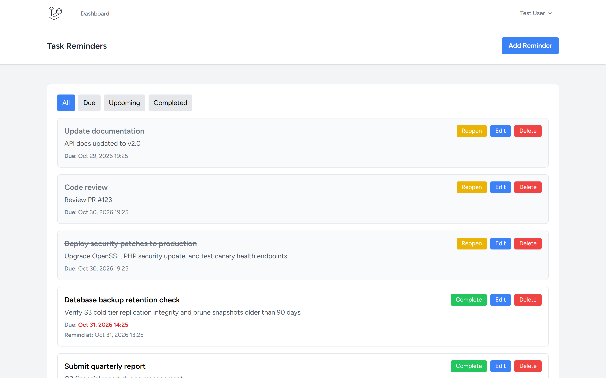
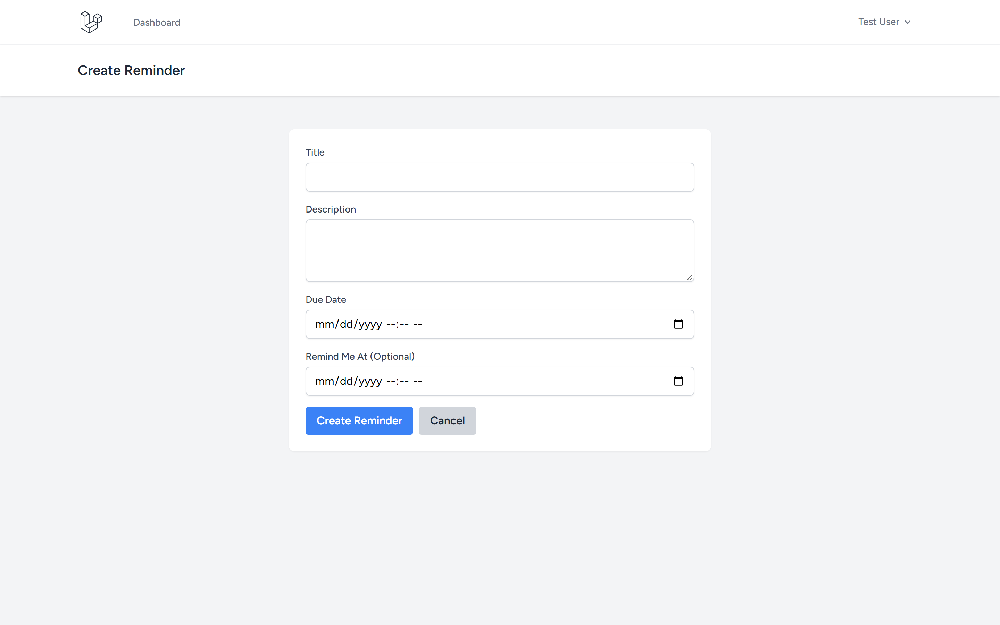
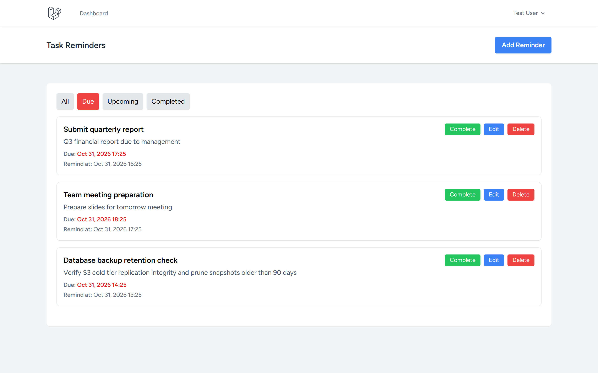
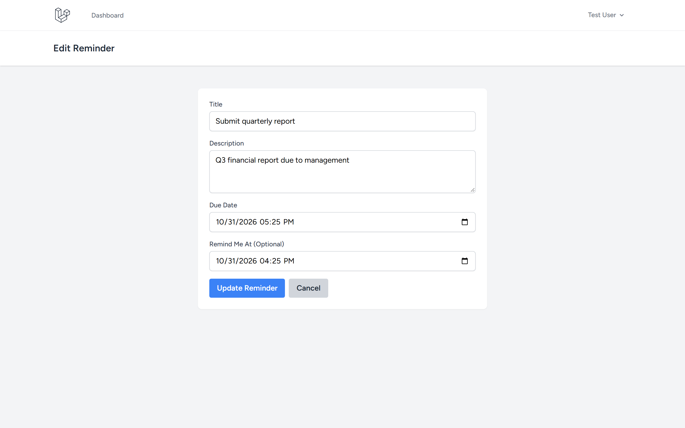

# Task Reminder App

A Laravel-based task reminder application with due date tracking, notification scheduling, and filtering capabilities.

Repository: https://github.com/0xyz-exe/task-reminder-app-laravel

## Screenshots

| Tampilan | Preview |
|---|---|
| **Dashboard Overview & Daftar Pengingat Tugas**<br>Tampilan antarmuka utama task reminder dengan filter status kategori (All, Due, Upcoming, Completed), visual due date highlighting merah untuk tugas mendesak, dan kontrol penyelesaian tugas cepat |  |
| **Formulir Pembuatan Pengingat Baru**<br>Formulir penjadwalan tugas interaktif dengan input judul, deskripsi tugas, due date picker, serta notifikasi pengingat terjadwal opsional (Remind Me At) |  |
| **Filter Pengingat Jatuh Tempo (Due Tasks)**<br>Halaman operasional penyaringan tugas jatuh tempo dengan status filter badge merah, pelabelan waktu kritis, dan aksi cepat Complete/Reopen/Edit/Delete |  |
| **Manajemen & Pembaruan Data Pengingat**<br>Formulir edit data pengingat terisi lengkap (pre-filled) dengan validasi authorization policy kepemilikan akun, penyesuaian deadline, dan tombol aksi terintegrasi |  |

## Features

- ✅ User authentication (Laravel Breeze)
- ✅ Create, edit, delete reminders
- ✅ Due date and optional reminder time
- ✅ Mark reminders as complete/incomplete
- ✅ Filter by: All, Due, Upcoming, Completed
- ✅ Visual due date highlighting
- ✅ Responsive Tailwind UI
- ✅ Authorization policies

## Tech Stack

- Laravel 13.38.0
- Laravel Breeze 2.4
- SQLite
- Tailwind CSS

## Installation

```bash
# Clone repository
git clone https://github.com/0xyz-exe/task-reminder-app-laravel.git
cd task-reminder-app-laravel

# Install dependencies
composer install
npm install && npm run build

# Setup environment
cp .env.example .env
php artisan key:generate

# Create database
touch database/database.sqlite

# Run migrations with demo data
php artisan migrate --seed

# Start server
php artisan serve
```

Visit `http://localhost:8000`

## Demo Account

- Email: `test@example.com`
- Password: `password`

## Database Schema

**reminders**
- id
- user_id (foreign key)
- title
- description (nullable)
- due_date (datetime)
- remind_at (datetime, nullable)
- completed (boolean)
- notified (boolean)
- timestamps

## Usage

1. **Login** with demo account
2. **Create Reminder** - Set title, description, due date, and optional reminder time
3. **Filter** - View all, due, upcoming, or completed reminders
4. **Complete** - Mark reminders as done
5. **Edit/Delete** - Manage existing reminders

## Filtering

- **All** - Every reminder
- **Due** - Overdue incomplete reminders (highlighted in red)
- **Upcoming** - Future incomplete reminders
- **Completed** - Finished tasks

## Security

- User authentication required
- Policy-based authorization
- CSRF protection
- Input validation
- SQL injection prevention

## License

MIT
